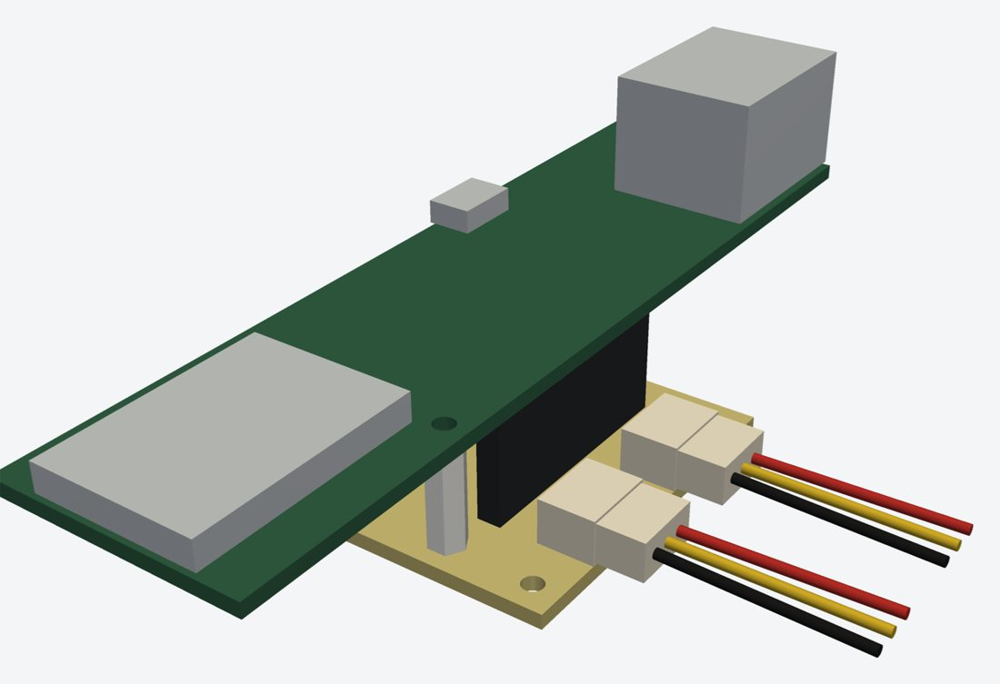
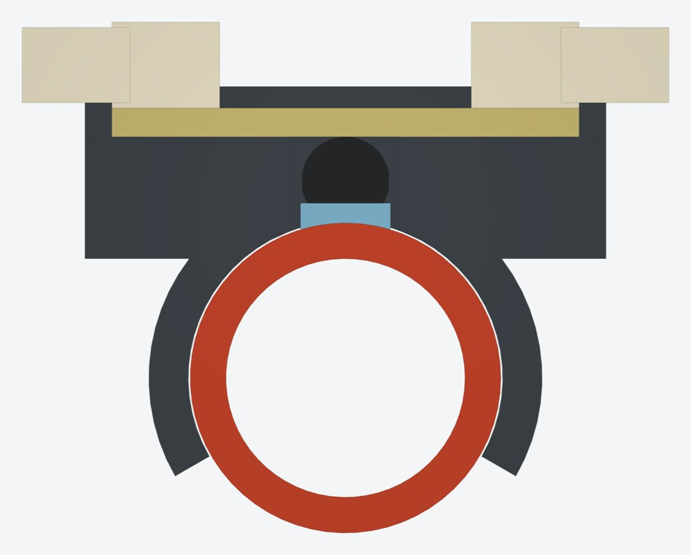

# FBH-Monitor

Überwachung der Vor- und Rücklauftemperaturen jedes Fußbodenheizkreises mit ESPHome und Home Assistant.
Zwei Heizkreisverteiler (EG und OG) mit je 7 Kreisen, versorgt über PoE.



## Funktionsweise

Pro Verteiler misst ein Modul 15 Temperaturen: den Vorlaufbalken als Referenz sowie Vor- und Rücklauf
jedes Kreises. Daraus berechnet ESPHome die Spreizung und erkennt, ob ein Kreis durchflossen wird.
Home Assistant vergleicht das mit dem Zustand der Stellantriebe der Einzelraumregelung und meldet
Abweichungen, Übertemperatur und ausgefallene Fühler.

Ein Kreis gilt als durchflossen, wenn

1. der Vorlaufbalken wärmer ist als *Heizbetrieb ab Vorlauf* (Standard 25 °C),
2. der Kreis-Vorlauf höchstens *Schwelle VL-Abfall* unter dem Balken liegt (Standard 2,0 K) und
3. die Spreizung mindestens *Schwelle Mindestspreizung* beträgt (Standard 1,0 K).

Die Schwellwerte lassen sich in Home Assistant auf der Geräteseite anpassen.

## Hardware

| Baugruppe | Beschreibung |
|---|---|
| Modul | Olimex ESP32-POE-ISO (WROOM, **nicht** WROVER), kopfüber auf einer eigenen Basisplatine 38 × 38 mm |
| Basisplatine | einseitig, Pull-ups 4,7 kΩ, zwei JST-PH-Buchsen für die Fühlerketten |
| Fühlerknoten | einseitig, 10 × 26 mm, DS18B20 (TO-92) mit Wärmeleitpad, JST-PH ein/aus |
| Rohrclips | gedruckt (PETG/ASA), Abgang Ø 17,3 mm, Vorlaufbalken Ø 26,7 mm |
| Verkabelung | zwei lineare 1-Wire-Ketten: A = Balken + 7 Vorläufe (GPIO32), B = 7 Rückläufe (GPIO33) |



Die vollständige Anleitung mit Schaltplänen, Maßzeichnungen, Bauteilliste und Inbetriebnahme liegt in
[`docs/bauanleitung.html`](docs/bauanleitung.html). Die Digi-Key-Positionen für beide Verteiler stehen in
[`bestellung/digikey_warenkorb.csv`](bestellung/digikey_warenkorb.csv).

## Verzeichnisse

```
esphome/                 ESPHome-Konfiguration
  fbh-eg.yaml            Verteiler Erdgeschoss (Fühleradressen, Offsets)
  fbh-og.yaml            Verteiler Obergeschoss
  common/fbh-basis.yaml  Board, Ethernet, 1-Wire-Ketten, Schwellwerte
  common/fbh-kreis.yaml  Vorlage für einen Heizkreis
  secrets.example.yaml   Vorlage für secrets.yaml
homeassistant/
  packages/fbh_monitor.yaml        Kreisfehler, Übertemperatur, Sensorausfall, Benachrichtigung
  custom_templates/fbh.jinja       Zuordnung Kreis ↔ Stellantrieb
  dashboard-karte.yaml             Dashboard-Karte
cad/
  fbh_cad.py             parametrische Modelle (CadQuery)
  export/                STEP- und druckfertige STL-Dateien
docs/                    Bauanleitung und Renderings
bestellung/              Digi-Key-Warenkorb
```

## Schnellstart

**ESPHome**

1. Ordner `esphome/` ins ESPHome-Dashboard kopieren.
2. `secrets.example.yaml` nach `secrets.yaml` kopieren und die API-Schlüssel eintragen (`openssl rand -base64 32`).
3. `fbh-eg.yaml` per USB flashen, danach per OTA.
4. Fühler einzeln an J1 stecken, Adresse aus dem Log übernehmen, kalibrieren, Offsets eintragen.

**Home Assistant**

1. In `configuration.yaml`:
   ```yaml
   homeassistant:
     packages: !include_dir_named packages
   ```
2. `packages/fbh_monitor.yaml` und `custom_templates/fbh.jinja` kopieren.
3. In `fbh.jinja` die Entitäten der Stellantriebe eintragen und neu laden.

**CAD**

```bash
pip install cadquery
cd cad
python fbh_cad.py          # Clips für Abgang (17,3 mm) und Balken (26,7 mm)
python fbh_cad.py 20.0     # Clip für beliebigen Rohrdurchmesser
```

Clips mit der Rastnasen-Seite nach unten drucken, ohne Stützmaterial, mit Brim.

## Status

- [x] Konzept, Schaltpläne, Bauteilliste
- [x] ESPHome- und Home-Assistant-Konfiguration (validiert mit ESPHome 2026.10)
- [x] Rohrclips und Distanzhülse als Druckdateien
- [ ] KiCad-Projekte für Basisplatine und Fühlerknoten
- [ ] Gehäuse für das Modul
- [ ] Erster Aufbau und Test am Verteiler

## Hinweise

- Die Pinbelegung von EXT1/EXT2 stammt aus dem KiCad-Layout des Olimex ESP32-POE-ISO (Rev. O).
- Das Olimex-Board ist in den CAD-Modellen vereinfacht (Umriss, Löcher, Steckleisten, Modul, RJ45, USB).
- Fertige JST-Kabel sind oft gedreht belegt. Jedes Kabel vor dem Einstecken prüfen: Pin 1 auf Pin 1.
